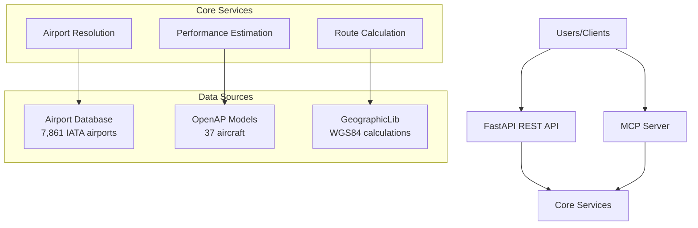

# Aerospace MCP - Flight Planning API & MCP Server

[](https://www.python.org/downloads/)
[](https://fastapi.tiangolo.com/)
[](https://github.com/TUDelft-CNS-ATM/openap)
[](https://modelcontextprotocol.io/)
[](https://numpy.org/)
[](https://cupy.dev/)
[](https://opensource.org/licenses/MIT)

A comprehensive aerospace research and flight planning service providing both HTTP API and Model Context Protocol (MCP) integration. Built with **FastMCP** for streamlined MCP server development. Features intelligent airport resolution, great-circle route calculation, aircraft performance estimation, atmospheric modeling, coordinate frame transformations, aerodynamic analysis, propeller performance modeling, rocket trajectory optimization, orbital mechanics calculations, and spacecraft trajectory planning for aerospace operations.

## ⚠️ SAFETY DISCLAIMER

**THIS SOFTWARE IS FOR EDUCATIONAL, RESEARCH, AND DEVELOPMENT PURPOSES ONLY**

- **NOT FOR REAL NAVIGATION**: Do not use for actual flight planning or navigation
- **NOT CERTIFIED**: This system is not certified by any aviation authority
- **ESTIMATES ONLY**: Performance calculations are theoretical estimates
- **NO WEATHER DATA**: Does not account for weather, NOTAMs, or airspace restrictions
- **NO LIABILITY**: Authors assume no responsibility for any consequences of use

For real flight planning, always use certified aviation software and consult official sources including NOTAMs, weather reports, and air traffic control.

## 🚀 Quick Start

The only prerequisite is [uv](https://docs.astral.sh/uv/), which also fetches
Python 3.11+ if your system has none. Releases on PyPI ship prebuilt wheels for
Linux (x86_64 and arm64, glibc 2.28+ and musl), macOS 11+ (Intel and Apple
Silicon) and Windows x64, so **no Rust toolchain or compiler is needed**.

```bash
curl -LsSf https://astral.sh/uv/install.sh | sh   # Linux / macOS
```

### Claude Code: MCP server + skills in one line

```bash
claude plugin marketplace add cheesejaguar/aerospace-mcp && claude plugin install aerospace-mcp@aerospace-mcp
```

Inside a session (Claude Code 2.1.275 or later) the same is
`/plugin install aerospace-mcp --marketplace cheesejaguar/aerospace-mcp`. The
plugin starts the MCP server with `uvx aerospace-mcp` and adds the skills in
[`skills/`](skills/). For the MCP server alone:
`claude mcp add aerospace -- uvx aerospace-mcp`.

### Skills for other agents (Cursor, Codex, OpenCode, ...)

```bash
npx skills add cheesejaguar/aerospace-mcp
```

The skills run tools through `uvx --from aerospace-mcp aerospace-mcp-cli`, so
they need uv too (and Node.js for `npx`).

### Claude Desktop and other MCP clients

```json
{
  "mcpServers": {
    "aerospace": {
      "command": "uvx",
      "args": ["aerospace-mcp"]
    }
  }
}
```

GUI apps on macOS do not inherit your shell's `PATH`: if the client cannot
find `uvx`, use the absolute path printed by `which uvx` (usually
`~/.local/bin/uvx`). The first launch downloads about 300 MB of dependencies;
run `uvx --from aerospace-mcp aerospace-mcp-cli list` once beforehand so the
client's server start-up timeout is not spent on the download.

### CLI and HTTP API

```bash
uvx --from aerospace-mcp aerospace-mcp-cli run hohmann_transfer --r1_m 6778000 --r2_m 42164000
uvx --from aerospace-mcp aerospace-mcp-http        # http://localhost:8080/docs
uv tool install aerospace-mcp                      # all three commands on PATH
```

Optional extras work the same way, e.g. `uvx --from 'aerospace-mcp[llm]'
aerospace-mcp` for the LLM agent tools (set `LLM_TOOLS_ENABLED=true` and
`OPENAI_API_KEY`).

### From source (development)

Building from a checkout compiles the native core, so it needs a Rust
toolchain:

```bash
curl --proto '=https' --tlsv1.2 -sSf https://sh.rustup.rs | sh   # Rust (rustup)
git clone https://github.com/cheesejaguar/aerospace-mcp.git
cd aerospace-mcp
uv sync                               # builds aerospace_mcp._native

cp .env.example .env                  # optional: host/port/log level, LLM tools
uv run aerospace-mcp                  # MCP server (stdio)
uv run aerospace-mcp sse 0.0.0.0 8001 # MCP server (SSE, debugging)
uv run aerospace-mcp-http             # HTTP API
uvicorn main:app --reload --port 8080 # HTTP API with auto-reload
```

### Docker

```bash
git clone https://github.com/cheesejaguar/aerospace-mcp.git
cd aerospace-mcp
docker build -t aerospace-mcp .
docker run -p 8080:8080 aerospace-mcp

# Test the API
curl "http://localhost:8080/health"
```

## 📋 Table of Contents

- [Features](#features)
- [Installation](#installation)
- [Usage Examples](#usage-examples)
- [Architecture](#architecture)
- [FastMCP Migration](#fastmcp-migration)
- [Performance](#performance)
- [API Documentation](#api-documentation)
- [MCP Integration](#mcp-integration)
- [Development](#development)
- [Contributing](#contributing)
- [License](#license)

## ✨ Features

### Core Capabilities

- **Airport Resolution**: Intelligent city-to-airport mapping with 7,861 IATA airports worldwide
- **Route Planning**: Great-circle distance calculation with geodesic precision
- **Performance Estimation**: Aircraft-specific fuel and time calculations via OpenAP
- **Atmospheric Modeling**: ISA atmosphere profiles with optional enhanced precision
- **Coordinate Transformations**: ECEF, ECI, geodetic frame conversions for aerospace analysis
- **Multiple Interfaces**: HTTP REST API and Model Context Protocol (MCP) support
- **Real-time Processing**: Sub-second response times for flight planning requests

### Space & Orbital Mechanics Capabilities

- 🛰️ **Orbital Elements & State Vectors**: Convert between Keplerian elements and Cartesian state vectors
- 🌍 **Orbit Propagation**: Numerical integration with J2 perturbations using RK4 method (native Rust core)
- 🗺️ **Ground Track Computation**: Calculate satellite ground tracks for mission planning
- 🔄 **Hohmann Transfers**: Calculate optimal two-impulse orbital transfers
- 🤝 **Orbital Rendezvous**: Plan multi-maneuver rendezvous sequences
- 🎯 **Trajectory Optimization**: Genetic algorithms and particle swarm optimization
- 📊 **Uncertainty Analysis**: Monte Carlo sampling for trajectory robustness assessment
- 🚀 **Lambert Problem**: Two-body trajectory determination for given time-of-flight (Izzo's 2015 algorithm, multi-revolution and retrograde; native Rust core)

### Supported Operations

- ✅ Airport search by city name or IATA code
- ✅ Flight route planning with polyline generation
- ✅ Aircraft performance estimation (37 aircraft models via OpenAP)
- ✅ Fuel consumption and flight time calculations
- ✅ Great-circle distance calculations
- ✅ Multi-leg journey planning (`plan_multi_leg_flight`, 2-10 waypoints with aggregated totals)
- ✅ Wind-aware flight planning (optional headwind-adjusted cruise speed, time, and fuel)
- ✅ Aircraft database browsing and search (`get_aircraft_database`)
- ✅ Unit conversions (length, speed, mass, pressure, temperature, angle)
- ✅ Aircraft comparison analysis
- ✅ Atmospheric profile calculation (ISA standard atmosphere)
- ✅ Wind profile modeling (logarithmic/power law)
- ✅ Coordinate frame transformations (ECEF, ECI, geodetic)
- ✅ Wing aerodynamics analysis (VLM, lifting line theory)
- ✅ Airfoil polar generation and database access
- ✅ Aircraft stability derivatives calculation
- ✅ Propeller performance analysis (BEMT)
- ✅ UAV energy optimization and endurance estimation
- ✅ Motor-propeller matching analysis
- ✅ 3DOF rocket trajectory simulation with atmosphere integration
- ✅ Rocket sizing estimation for mission planning
- ✅ Launch angle optimization for maximum performance
- ✅ Thrust profile optimization using gradient descent
- ✅ Trajectory sensitivity analysis for design studies
- ✅ System capability discovery and status reporting
- ✅ **Orbital mechanics calculations** (Keplerian elements, state vectors, propagation)
- ✅ **Ground track computation** for satellite tracking and visualization
- ✅ **Hohmann transfer planning** for orbital maneuvers and mission design
- ✅ **Orbital rendezvous planning** for spacecraft proximity operations
- ✅ **Trajectory optimization** using genetic algorithms and particle swarm optimization
- ✅ **Monte Carlo uncertainty analysis** for trajectory robustness assessment
- ✅ **Lambert problem solving** for two-body trajectory determination
- ✅ **Porkchop plot generation** for interplanetary transfer opportunity analysis
- ✅ **Optional SPICE integration** with fallback to simplified ephemeris models
- ✅ **Density altitude calculation** for performance planning
- ✅ **Airspeed conversions** (IAS/CAS/EAS/TAS/Mach)
- ✅ **Stall speed calculation** for different configurations
- ✅ **Weight and balance** calculations with CG limits
- ✅ **Takeoff/landing performance** distance and V-speeds
- ✅ **Fuel reserve calculation** per FAR/ICAO regulations
- ✅ **Kalman filter state estimation** for sensor fusion
- ✅ **LQR controller design** for optimal control

### Technical Features

- 🚀 **Fast**: In-memory airport database for microsecond lookups
- 🔧 **Flexible**: Pluggable backend system (currently OpenAP)
- 📊 **Accurate**: Uses WGS84 geodesic calculations
- 🌐 **Standards**: Follows ICAO aircraft codes and IATA airport codes
- 🔒 **Reliable**: Comprehensive error handling and graceful degradation
- 📚 **Well-documented**: Complete API documentation with examples
- ⚡ **Hardware Optimized**: NumPy vectorization with CuPy GPU acceleration support
- 🔄 **Batch Processing**: Vectorized operations for efficient bulk calculations
- 🔍 **Tool Discovery**: Dynamic tool search for finding relevant tools from 47 specialized tools plus 2 discovery tools

## 💾 Installation

### System Requirements

- **uv** (recommended) or **pip** with **Python 3.11+**
- **Prebuilt wheels**: Linux x86_64/arm64 (glibc 2.28+ or musl 1.2+), macOS 11+
  (Intel and Apple Silicon), Windows x64. Other platforms install from the
  source distribution, which needs a [Rust toolchain](https://rustup.rs).
- **Disk**: about 300 MB for the default install (about 500 MB with `[llm]`)
- **Network**: for the first install; the airport database and aircraft
  models ship with the packages and work offline

### With uv (no clone)

```bash
uvx aerospace-mcp                               # MCP server (stdio), run in place
uvx --from aerospace-mcp aerospace-mcp-cli list # any command, run in place
uv tool install aerospace-mcp                   # install the commands on PATH
uv tool upgrade aerospace-mcp                   # later: upgrade
```

`uvx` caches the environment after the first run. To pick up a new release
with `uvx`, run `uvx aerospace-mcp@latest` once.

### With pip

```bash
python3 -m venv .venv && source .venv/bin/activate   # Windows: .venv\Scripts\activate
python -m pip install --upgrade pip                  # old pips miss the manylinux_2_28 / musllinux wheels
pip install aerospace-mcp                            # or 'aerospace-mcp[llm]', 'aerospace-mcp[all]'
aerospace-mcp-cli list
```

Extras: `llm` (LLM agent tools), `atmosphere`, `aircraft`, `rockets`,
`space`, `gnc`, `all`.

### From source

See [From source (development)](#from-source-development): `uv sync` (or
`pip install -e .`) in a checkout, with Rust installed via
[rustup](https://rustup.rs).

### Docker

```bash
git clone https://github.com/cheesejaguar/aerospace-mcp.git
cd aerospace-mcp
docker build -t aerospace-mcp .
docker run -d -p 8080:8080 --name aerospace-mcp aerospace-mcp
curl http://localhost:8080/health
```

The image builds the native core itself (Rust is installed in the build
stage only) and includes the `llm` extra.

### Troubleshooting Installation

**The MCP client cannot start the server / `uvx: command not found`**: GUI
apps (Claude Desktop on macOS in particular) do not see the `PATH` from your
shell profile. Put the absolute path from `which uvx` in the `command` field.

**The MCP client times out on first launch**: the first `uvx` run downloads
the dependencies. Run `uvx --from aerospace-mcp aerospace-mcp-cli list` once
in a terminal, then restart the client.

**`error: can't find Rust compiler` / `Failed to build aerospace-mcp`**: the
installer found no wheel for your platform and fell back to the source
distribution. Upgrade pip (`python -m pip install --upgrade pip`); if your
platform has no prebuilt wheel (see above), install Rust with
`curl --proto '=https' --tlsv1.2 -sSf https://sh.rustup.rs | sh` and retry.

**LLM agent tools report that LiteLLM is not installed**: install the `llm`
extra (`pip install 'aerospace-mcp[llm]'`, or
`uvx --from 'aerospace-mcp[llm]' aerospace-mcp`).

**Check an installation**:

```bash
aerospace-mcp-cli run get_system_status   # optional packages and their versions
aerospace-mcp-cli run hohmann_transfer --r1_m 6778000 --r2_m 42164000
```

## 🎯 Usage Examples

### HTTP API Examples

#### Basic Flight Planning

```bash
# Plan a simple flight
curl -X POST "http://localhost:8080/plan" \
  -H "Content-Type: application/json" \
  -d '{
    "depart_city": "San Francisco",
    "arrive_city": "New York",
    "ac_type": "A320",
    "cruise_alt_ft": 37000,
    "backend": "openap"
  }'
```

#### Airport Search

```bash
# Find airports by city
curl "http://localhost:8080/airports/by_city?city=Tokyo"

# Filter by country
curl "http://localhost:8080/airports/by_city?city=London&country=GB"

# Multiple results
curl "http://localhost:8080/airports/by_city?city=Paris"
```

#### Advanced Flight Planning

```bash
# Specify exact airports and aircraft mass
curl -X POST "http://localhost:8080/plan" \
  -H "Content-Type: application/json" \
  -d '{
    "depart_city": "Los Angeles",
    "arrive_city": "Tokyo",
    "prefer_depart_iata": "LAX",
    "prefer_arrive_iata": "NRT",
    "ac_type": "B777",
    "cruise_alt_ft": 39000,
    "mass_kg": 220000,
    "route_step_km": 100.0,
    "backend": "openap"
  }'
```

### Python Client Examples

#### Simple Client

```python
import requests
import json

class AerospaceClient:
    def __init__(self, base_url="http://localhost:8080"):
        self.base_url = base_url

    def plan_flight(self, departure, arrival, aircraft="A320", altitude=35000):
        """Plan a flight between two cities."""
        response = requests.post(f"{self.base_url}/plan", json={
            "depart_city": departure,
            "arrive_city": arrival,
            "ac_type": aircraft,
            "cruise_alt_ft": altitude,
            "backend": "openap"
        })
        return response.json()

    def find_airports(self, city, country=None):
        """Find airports in a city."""
        params = {"city": city}
        if country:
            params["country"] = country
        response = requests.get(f"{self.base_url}/airports/by_city", params=params)
        return response.json()

# Usage
client = AerospaceClient()

# Find airports
airports = client.find_airports("Sydney", "AU")
print(f"Sydney has {len(airports)} airports")

# Plan flight
plan = client.plan_flight("Sydney", "Melbourne", "B737")
print(f"Flight distance: {plan['distance_nm']:.0f} NM")
print(f"Flight time: {plan['estimates']['block']['time_min']:.0f} minutes")
```

#### Batch Processing

```python
import asyncio
import aiohttp
from typing import List, Dict

async def plan_multiple_flights(flights: List[Dict]) -> List[Dict]:
    """Plan multiple flights concurrently."""
    async with aiohttp.ClientSession() as session:
        tasks = []
        for flight in flights:
            task = plan_single_flight(session, flight)
            tasks.append(task)

        results = await asyncio.gather(*tasks, return_exceptions=True)
        return results

async def plan_single_flight(session, flight_data):
    """Plan a single flight."""
    async with session.post(
        "http://localhost:8080/plan",
        json=flight_data
    ) as response:
        return await response.json()

# Example usage
flights_to_plan = [
    {"depart_city": "New York", "arrive_city": "London", "ac_type": "A330"},
    {"depart_city": "London", "arrive_city": "Dubai", "ac_type": "B777"},
    {"depart_city": "Dubai", "arrive_city": "Singapore", "ac_type": "A350"}
]

# Run the batch planning
results = asyncio.run(plan_multiple_flights(flights_to_plan))
for i, result in enumerate(results):
    if not isinstance(result, Exception):
        print(f"Flight {i+1}: {result['distance_nm']:.0f} NM, {result['estimates']['block']['time_min']:.0f} min")
```

### Orbital Mechanics Examples

#### Python Examples

```python
import requests

class OrbitalMechanicsClient:
    def __init__(self, base_url="http://localhost:8080"):
        self.base_url = base_url

    def plan_hohmann_transfer(self, r1_km, r2_km):
        """Calculate Hohmann transfer between two circular orbits."""
        response = requests.post(f"{self.base_url}/hohmann_transfer", json={
            "r1_m": r1_km * 1000,  # Convert to meters
            "r2_m": r2_km * 1000
        })
        return response.json()

    def propagate_satellite_orbit(self, elements, duration_hours):
        """Propagate satellite orbit with J2 perturbations."""
        response = requests.post(f"{self.base_url}/propagate_orbit_j2", json={
            "initial_state": elements,
            "propagation_time_s": duration_hours * 3600,
            "time_step_s": 300  # 5-minute steps
        })
        return response.json()

# Example usage
client = OrbitalMechanicsClient()

# Plan a GTO to GEO transfer
gto_alt = 200    # km (perigee)
geo_alt = 35786  # km (GEO altitude)

transfer = client.plan_hohmann_transfer(
    6378 + gto_alt,  # Earth radius + altitude
    6378 + geo_alt
)

print(f"Transfer Delta-V: {transfer['delta_v_total_ms']/1000:.2f} km/s")
print(f"Transfer Time: {transfer['transfer_time_h']:.1f} hours")

# Propagate ISS orbit for one day
iss_elements = {
    "semi_major_axis_m": 6793000,  # ~415 km altitude
    "eccentricity": 0.0001,
    "inclination_deg": 51.6,
    "raan_deg": 0.0,
    "arg_periapsis_deg": 0.0,
    "true_anomaly_deg": 0.0,
    "epoch_utc": "2024-01-01T12:00:00"
}

orbit_states = client.propagate_satellite_orbit(iss_elements, 24)
print(f"Propagated {len(orbit_states)} orbital states over 24 hours")
```

#### Trajectory Optimization Example

```python
# Optimize a lunar transfer trajectory
def optimize_lunar_transfer():
    initial_trajectory = [
        {
            "time_s": 0,
            "position_m": [6700000, 0, 0],      # LEO
            "velocity_ms": [0, 7500, 0]
        },
        {
            "time_s": 86400 * 3,  # 3 days
            "position_m": [384400000, 0, 0],    # Moon distance
            "velocity_ms": [0, 1000, 0]
        }
    ]

    response = requests.post("http://localhost:8080/genetic_algorithm_optimization", json={
        "initial_trajectory": initial_trajectory,
        "objective": "minimize_delta_v",
        "constraints": {
            "max_thrust_n": 50000,
            "max_acceleration_ms2": 10
        }
    })

    result = response.json()
    print(f"Optimized Delta-V: {result['total_delta_v_ms']/1000:.2f} km/s")
    print(f"Flight Time: {result['flight_time_s']/86400:.1f} days")
    return result

optimized_trajectory = optimize_lunar_transfer()

# Generate porkchop plot for Mars mission planning
def plan_mars_mission():
    response = requests.post("http://localhost:8080/porkchop_plot_analysis", json={
        "departure_body": "Earth",
        "arrival_body": "Mars",
        "min_tof_days": 200,
        "max_tof_days": 300
    })

    analysis = response.json()

    if analysis["summary_statistics"]["feasible_transfers"] > 0:
        optimal = analysis["optimal_transfer"]
        print(f"Optimal Mars Transfer:")
        print(f"  Launch: {optimal['departure_date']}")
        print(f"  Arrival: {optimal['arrival_date']}")
        print(f"  C3: {optimal['c3_km2_s2']:.2f} km²/s²")
        print(f"  Flight Time: {optimal['time_of_flight_days']:.0f} days")
    else:
        print("No feasible transfers found in date range")

plan_mars_mission()
```

### JavaScript/TypeScript Examples

```typescript
interface FlightPlan {
  depart_city: string;
  arrive_city: string;
  ac_type: string;
  cruise_alt_ft?: number;
  backend: "openap";
}

class AerospaceAPI {
  constructor(private baseUrl: string = "http://localhost:8080") {}

  async planFlight(request: FlightPlan) {
    const response = await fetch(`${this.baseUrl}/plan`, {
      method: "POST",
      headers: { "Content-Type": "application/json" },
      body: JSON.stringify(request),
    });

    if (!response.ok) {
      throw new Error(`API Error: ${response.statusText}`);
    }

    return await response.json();
  }

  async findAirports(city: string, country?: string) {
    const params = new URLSearchParams({ city });
    if (country) params.append("country", country);

    const response = await fetch(`${this.baseUrl}/airports/by_city?${params}`);
    return await response.json();
  }
}

// Usage
const api = new AerospaceAPI();

try {
  const plan = await api.planFlight({
    depart_city: "Boston",
    arrive_city: "Seattle",
    ac_type: "B737",
    cruise_alt_ft: 36000,
    backend: "openap"
  });

  console.log(`Flight planned: ${plan.distance_nm} NM`);
  console.log(`Estimated time: ${plan.estimates.block.time_min} minutes`);
} catch (error) {
  console.error("Flight planning failed:", error);
}
```

## 🏗️ Architecture

### System Overview



### Key Components

1. **FastAPI Application** (`main.py`)
   - RESTful endpoints for HTTP clients
   - Auto-generated OpenAPI documentation
   - Request/response validation with Pydantic

2. **MCP Server** (`aerospace_mcp/fastmcp_server.py`)
   - Model Context Protocol implementation via FastMCP
   - Tool-based interface for AI assistants
   - Async request handling

3. **Core Services**
   - **Airport Resolution**: City → Airport mapping with intelligent selection
   - **Route Calculation**: Great-circle paths with polyline generation
   - **Performance Estimation**: OpenAP-based fuel and time calculations

4. **Data Layer**
   - **In-memory Airport Database**: 7,861 IATA airports loaded at startup
   - **OpenAP Integration**: Aircraft performance models
   - **GeographicLib**: Precise geodesic calculations

5. **Native Core** (`rust/`, imported as `aerospace_mcp._native`)
   - Rust + PyO3 extension for the numerically heavy code: 3-DOF rocket
     simulation and performance analysis, the launch-angle and
     thrust-profile optimizers, Kepler / element conversions, J2 orbit
     propagation, ground tracks, Hohmann transfers, and Izzo's Lambert solver
   - Optimizers evaluate every candidate trajectory natively (no Python
     call per evaluation), roughly 190x faster than the former pure-Python
     loop; the MCP server, tool wrappers and data models remain Python

### Design Principles

- **Performance First**: In-memory data structures for sub-millisecond lookups
- **Graceful Degradation**: Works without optional dependencies
- **Type Safety**: Full type hints and Pydantic validation
- **Extensible**: Plugin architecture for new backends
- **Standards Compliant**: ICAO, IATA, and OpenAP standards
- **Hardware Agnostic**: NumPy/CuPy abstraction for CPU/GPU flexibility

## 🚀 FastMCP Migration

This project has been **migrated from the traditional MCP SDK to FastMCP**, providing significant improvements in developer experience and code maintainability.

### What is FastMCP?

[FastMCP](https://github.com/jlowin/fastmcp) is a high-level, Pythonic framework for building Model Context Protocol servers. It dramatically reduces boilerplate code while maintaining full MCP compatibility.

### Migration Benefits

✅ **70% Less Code**: Tool definitions went from verbose JSON schemas to simple Python decorators
✅ **Better Type Safety**: Automatic schema generation from type hints
✅ **Cleaner Architecture**: Modular tool organization across logical domains
✅ **Improved Maintainability**: Pythonic code that's easier to read and extend
✅ **Full Compatibility**: Same MCP protocol, works with all existing clients

### Before vs After

**Before (Traditional MCP SDK):**
```python
Tool(
    name="search_airports",
    description="Search for airports by IATA code or city name",
    inputSchema={
        "type": "object",
        "properties": {
            "query": {"type": "string", "description": "IATA code or city name"},
            "country": {"type": "string", "description": "Optional country filter"},
            "query_type": {"type": "string", "enum": ["iata", "city", "auto"]}
        },
        "required": ["query"]
    }
)

@server.call_tool()
async def handle_call_tool(name: str, arguments: dict):
    if name == "search_airports":
        return await _handle_search_airports(arguments)
    # ... 40+ more tool handlers
```

**After (FastMCP):**
```python
@mcp.tool
def search_airports(
    query: str,
    country: str | None = None,
    query_type: Literal["iata", "city", "auto"] = "auto"
) -> str:
    """Search for airports by IATA code or city name."""
    # Implementation here
```

### Architecture Improvements

The FastMCP refactoring introduced a **modular architecture** with tools organized by domain:

- `tools/core.py` - Core flight planning (search, plan, distance, performance)
- `tools/atmosphere.py` - Atmospheric modeling and wind analysis
- `tools/frames.py` - Coordinate frame transformations
- `tools/aerodynamics.py` - Wing analysis and airfoil polars
- `tools/propellers.py` - Propeller BEMT and UAV energy analysis
- `tools/rockets.py` - Rocket trajectory and sizing
- `tools/orbits.py` - Orbital mechanics and propagation
- `tools/optimization.py` - Trajectory optimization algorithms

**Integration modules** with NumPy vectorization:

- `integrations/_array_backend.py` - NumPy/CuPy abstraction layer for GPU support
- `integrations/atmosphere.py` - Vectorized ISA atmosphere calculations
- `integrations/aero.py` - Vectorized aerodynamics computations
- `integrations/rockets.py` - Vectorized trajectory integration
- `integrations/frames.py` - Vectorized coordinate transformations

### Compatibility Notes

- **Entry Point**: Now uses `aerospace_mcp.fastmcp_server:run`
- **Dependencies**: Includes `fastmcp>=2.11.3` instead of raw `mcp`
- **Server Name**: Still `aerospace-mcp` for client compatibility
- **All Tools**: All 47 tools maintain exact same names and parameters

## ⚙️ Configuration (.env)

Both the HTTP server and MCP servers automatically load environment variables from a local `.env` (via `python-dotenv`).

- `AEROSPACE_MCP_MODE`: `http` or `mcp` (Docker entrypoint switch)
- `AEROSPACE_MCP_HOST`: Bind host for HTTP (default `0.0.0.0`)
- `AEROSPACE_MCP_PORT`: Port for HTTP (default `8080`)
- `AEROSPACE_MCP_LOG_LEVEL`: `debug|info|warning|error` (default `info`)
- `AEROSPACE_MCP_ENV`: `development|production` (controls reload)
- `LLM_TOOLS_ENABLED`: `true|false` to enable AI agent tools (default `false`)
- `OPENAI_API_KEY`: Required if LLM tools are enabled

HTTP API hardening (the FastAPI app in `main.py` is a thin layer over `aerospace_mcp/core.py`):

- `CORS_ORIGINS`: Comma-separated list of allowed origins; CORS is disabled when unset
- `RATE_LIMIT_RPM`: Per-IP requests per minute (default `120`, `0` disables rate limiting)
- `MAX_BODY_BYTES`: Maximum accepted request body size (default 1 MiB)

Example `.env`:

```
AEROSPACE_MCP_MODE=http
AEROSPACE_MCP_HOST=0.0.0.0
AEROSPACE_MCP_PORT=8080
AEROSPACE_MCP_LOG_LEVEL=debug
LLM_TOOLS_ENABLED=false
# OPENAI_API_KEY=sk-...
```

## ⚡ Performance

### Benchmarks

| Operation | Response Time | Throughput | Memory Usage |
|-----------|---------------|------------|--------------|
| Health Check | < 1ms | 10,000+ req/sec | ~5MB |
| Airport Search | 1-5ms | 1,000+ req/sec | ~50MB |
| Flight Planning | 200-500ms | 5-10 req/sec | ~100MB |
| Distance Calc | 10-50ms | 100+ req/sec | ~50MB |

### Optimization Tips

1. **Route Resolution**: Use larger `route_step_km` values for faster processing
2. **Caching**: Implement client-side caching for repeated requests
3. **Batch Processing**: Use async clients for multiple concurrent requests
4. **Memory**: Increase available RAM for better OpenAP performance

### Scaling Considerations

- **Horizontal Scaling**: Stateless design allows multiple instances
- **Load Balancing**: Standard HTTP load balancers work well
- **Database**: Consider external database for airport data at scale
- **Caching**: Add Redis for shared cache across instances

### GPU Acceleration (CuPy)

The aerospace calculations are optimized using NumPy's vectorized operations, with a drop-in CuPy backend for GPU acceleration on CUDA-capable hardware.

#### Enabling GPU Acceleration

```python
# In your code, before using aerospace functions:
from aerospace_mcp.integrations._array_backend import set_backend, get_backend_info

# Check available backends
print(get_backend_info())
# {'current_backend': 'numpy', 'numpy_available': True, 'cupy_available': True, ...}

# Switch to GPU (requires CuPy and CUDA)
set_backend('cupy')

# Switch back to CPU
set_backend('numpy')
```

#### Installing CuPy

```bash
# For CUDA 11.x
pip install cupy-cuda11x

# For CUDA 12.x
pip install cupy-cuda12x

# Auto-detect CUDA version
pip install cupy
```

#### Modules with GPU Support

The following integration modules support GPU acceleration via the array backend:

| Module | Operations | Speedup (GPU vs CPU) |
|--------|------------|---------------------|
| `atmosphere.py` | ISA calculations, wind profiles | 10-50x for large batches |
| `aero.py` | Wing analysis, airfoil polars | 5-20x for alpha sweeps |
| `rockets.py` | Trajectory integration, performance analysis | 3-10x |
| `frames.py` | Coordinate transformations (batch) | 20-100x for large datasets |

**Note**: GPU acceleration provides the most benefit for batch operations with 1000+ data points. For single calculations, CPU (NumPy) is typically faster due to GPU transfer overhead.

## 📖 API Documentation

### Interactive Documentation

When running the server, comprehensive API documentation is available at:
- **Swagger UI**: http://localhost:8080/docs
- **ReDoc**: http://localhost:8080/redoc
- **OpenAPI Schema**: http://localhost:8080/openapi.json

### Core Endpoints

#### GET /health
Health check and system status.

**Response**:
```json
{
  "status": "ok",
  "openap": true,
  "airports_count": 7861
}
```

#### GET /airports/by_city
Search airports by city name.

**Parameters**:
- `city` (required): City name to search
- `country` (optional): ISO country code filter

**Example**: `GET /airports/by_city?city=London&country=GB`

#### POST /plan
Generate complete flight plan.

**Request Body**:
```json
{
  "depart_city": "San Francisco",
  "arrive_city": "New York",
  "ac_type": "A320",
  "cruise_alt_ft": 37000,
  "mass_kg": 65000,
  "route_step_km": 25.0,
  "backend": "openap"
}
```

**Response**: Complete flight plan with route polyline and performance estimates.

### Error Handling

All endpoints return standard HTTP status codes:
- `200`: Success
- `400`: Bad Request (invalid parameters)
- `404`: Not Found (airport/city not found)
- `501`: Not Implemented (backend unavailable)

Error responses include detailed messages:
```json
{
  "detail": "departure: IATA 'XYZ' not found."
}
```

## 🤖 MCP Integration

### Supported MCP Clients

- **Claude Desktop**: Native integration
- **VS Code Continue**: Plugin support
- **Custom Clients**: Standard MCP protocol

### Available Tools

| Tool | Description | Parameters |
|------|-------------|------------|
| `search_airports` | Find airports by IATA or city | `query`, `country`, `query_type` |
| `plan_flight` | Complete flight planning (optional wind-aware estimates) | `departure`, `arrival`, `aircraft`, `route_options`, `wind` |
| `plan_multi_leg_flight` | Multi-leg journeys through 2-10 waypoints with aggregated totals | `waypoints`, `aircraft` |
| `get_aircraft_database` | Browse/search available OpenAP aircraft types | `search` |
| `convert_units` | Length/speed/mass/pressure/temperature/angle conversions | `value`, `from_unit`, `to_unit` |
| `calculate_distance` | Great-circle distance | `lat1`, `lon1`, `lat2`, `lon2` |
| `get_aircraft_performance` | Performance estimates | `aircraft_type`, `distance_km`, `cruise_altitude_ft` |
| `get_atmosphere_profile` | ISA atmosphere conditions | `altitudes_m`, `model_type` |
| `wind_model_simple` | Wind profile calculation | `altitudes_m`, `surface_wind_speed_ms`, `surface_wind_direction_deg`, `model_type`, `roughness_length_m` |
| `transform_frames` | Coordinate transformations | `coordinates`, `from_frame`, `to_frame`, `epoch_utc` |
| `geodetic_to_ecef` | Lat/lon to ECEF conversion | `latitude_deg`, `longitude_deg`, `altitude_m` |
| `ecef_to_geodetic` | ECEF to lat/lon conversion | `x_m`, `y_m`, `z_m` |
| `wing_vlm_analysis` | Wing aerodynamics analysis (VLM) | `wing_config`, `flight_conditions`, `analysis_options` |
| `airfoil_polar_analysis` | Airfoil polar generation | `airfoil_name`, `reynolds_number`, `mach_number`, `alpha_range_deg` |
| `calculate_stability_derivatives` | Stability derivatives calculation | `wing_config`, `flight_conditions` |
| `propeller_bemt_analysis` | Propeller performance (BEMT) | `propeller_geometry`, `operating_conditions`, `analysis_options` |
| `uav_energy_estimate` | UAV endurance and energy analysis | `uav_config`, `battery_config`, `mission_profile` |
| `get_airfoil_database` | Available airfoil coefficients | None |
| `get_propeller_database` | Available propeller data | None |
| `rocket_3dof_trajectory` | 3DOF rocket trajectory simulation | `rocket_geometry`, `launch_conditions`, `simulation_options` |
| `estimate_rocket_sizing` | Rocket sizing for mission requirements | `target_altitude_m`, `payload_mass_kg`, `propellant_type`, `design_margin` |
| `optimize_launch_angle` | Launch angle optimization | `rocket_geometry`, `target_range_m`, `optimize_for`, `angle_bounds_deg` |
| `optimize_thrust_profile` | Thrust profile optimization | `rocket_geometry`, `burn_time_s`, `total_impulse_target`, `n_segments`, `objective` |
| `trajectory_sensitivity_analysis` | Parameter sensitivity analysis | `rocket_geometry`, `parameter_variations`, `analysis_options` |
| `get_system_status` | System health and capabilities | None |
| `elements_to_state_vector` | Convert orbital elements to state vector | `orbital_elements` |
| `state_vector_to_elements` | Convert state vector to orbital elements | `state_vector` |
| `propagate_orbit_j2` | Propagate orbit with J2 perturbations | `initial_state`, `propagation_time_s`, `time_step_s`, `max_points` |
| `calculate_ground_track` | Calculate satellite ground track | `orbital_state`, `duration_s`, `time_step_s`, `max_points` |
| `hohmann_transfer` | Calculate Hohmann transfer orbit | `r1_m`, `r2_m` |
| `orbital_rendezvous_planning` | Plan orbital rendezvous maneuvers | `chaser_elements`, `target_elements`, `rendezvous_options` |
| `genetic_algorithm_optimization` | Trajectory optimization using GA | `optimization_problem`, `ga_parameters` |
| `particle_swarm_optimization` | Trajectory optimization using PSO | `optimization_problem`, `pso_parameters` |
| `monte_carlo_uncertainty_analysis` | Monte Carlo trajectory uncertainty analysis | `nominal_trajectory`, `uncertainty_parameters`, `n_samples`, `analysis_options` |
| `porkchop_plot_analysis` | Generate porkchop plot for interplanetary transfers | `departure_body`, `arrival_body`, `departure_date_range`, `arrival_date_range`, `analysis_options` |
| `search_aerospace_tools` | Search for tools by name, description, or functionality | `query`, `search_type`, `max_results`, `category` |
| `list_tool_categories` | List all available tool categories with counts | None |
| `lambert_problem_solver` | Solve Lambert's problem for orbital transfers | `r1_m`, `r2_m`, `tof_s`, `direction`, `num_revolutions`, `central_body` |
| `density_altitude_calculator` | Calculate density altitude from pressure altitude and temperature | `pressure_altitude_ft`, `temperature_c`, `dewpoint_c` |
| `true_airspeed_converter` | Convert between IAS/CAS/EAS/TAS/Mach | `speed_value`, `speed_type`, `altitude_ft`, `temperature_c`, `position_error_kts` |
| `stall_speed_calculator` | Calculate stall speeds for different configurations | `weight_kg`, `wing_area_m2`, `cl_max_clean`, `cl_max_takeoff`, `cl_max_landing`, `altitude_ft`, `load_factor` |
| `weight_and_balance` | Calculate aircraft weight and CG position | `basic_empty_weight_kg`, `basic_empty_arm_m`, `fuel_kg`, `fuel_arm_m`, `payload_items`, `forward_cg_limit_m`, `aft_cg_limit_m`, `max_takeoff_weight_kg`, `mac_m`, `lemac_m` |
| `takeoff_performance` | Calculate takeoff distances and V-speeds | `weight_kg`, `pressure_altitude_ft`, `temperature_c`, `wind_kts`, `runway_slope_pct`, `runway_condition`, `thrust_to_weight`, `cl_max_takeoff`, `wing_area_m2`, `cd0`, `oswald_e`, `aspect_ratio` |
| `landing_performance` | Calculate landing distances and approach speeds | `weight_kg`, `pressure_altitude_ft`, `temperature_c`, `wind_kts`, `runway_slope_pct`, `runway_condition`, `cl_max_landing`, `wing_area_m2`, `vref_factor`, `approach_angle_deg` |
| `fuel_reserve_calculator` | Calculate required fuel reserves per regulations | `regulation`, `trip_fuel_kg`, `cruise_fuel_flow_kg_hr`, `flight_time_min`, `alternate_fuel_kg`, `holding_altitude_ft` |
| `kalman_filter_state_estimation` | State estimation using Kalman filter | `initial_state`, `initial_covariance`, `process_noise`, `measurement_noise`, `measurements`, `dynamics_model`, `dt`, `initial_time` |
| `lqr_controller_design` | Design LQR optimal controller | `A_matrix`, `B_matrix`, `Q_matrix`, `R_matrix`, `state_names`, `input_names` |

### Claude Desktop Setup

1. Open Claude Desktop Settings
2. Add server configuration:

```json
{
  "mcpServers": {
    "aerospace": {
      "command": "uvx",
      "args": ["aerospace-mcp"]
    }
  }
}
```

   From a source checkout use `"command": "uv"` with
   `"args": ["--directory", "/path/to/aerospace-mcp", "run", "aerospace-mcp"]`.
   If Claude Desktop cannot find `uvx`, give its absolute path (`which uvx`).

3. Restart Claude Desktop
4. Test with: "Search for airports in Tokyo"

### Tool Discovery

With 47 specialized aerospace tools available (plus 2 discovery tools), the MCP server includes a **tool search tool** following [Anthropic's guide](https://platform.claude.com/docs/en/agents-and-tools/tool-use/tool-search-tool) for dynamic tool discovery:

```python
# Search by natural language
search_aerospace_tools("atmospheric pressure altitude")
# Returns: get_atmosphere_profile, wind_model_simple, ...

# Search by regex pattern
search_aerospace_tools("(?i)orbit", search_type="regex")
# Returns: propagate_orbit_j2, elements_to_state_vector, hohmann_transfer, ...

# Filter by category
search_aerospace_tools("calculate", category="orbits")
# Returns only orbital mechanics tools matching "calculate"

# List all categories
list_tool_categories()
# Returns: core, atmosphere, frames, aerodynamics, propellers, rockets, orbits, gnc, performance, optimization, agents
```

Available categories:
- **core**: Flight planning, airports, distance, aircraft performance
- **atmosphere**: ISA profiles, wind modeling
- **frames**: Coordinate transformations (ECEF, ECI, geodetic)
- **aerodynamics**: Wing analysis, airfoil polars, stability derivatives
- **propellers**: BEMT analysis, UAV energy estimation
- **rockets**: 3DOF trajectory, sizing, launch optimization
- **orbits**: Orbital elements, propagation, transfers, rendezvous, Lambert solver
- **optimization**: GA, PSO, Monte Carlo, porkchop plots
- **gnc**: Kalman filter state estimation, LQR controller design
- **performance**: Density altitude, airspeed conversion, stall speeds, W&B, takeoff/landing
- **agents**: LLM-powered tool selection and data formatting

### Deferred Tool Loading

For applications with many tools, aerospace-mcp supports [deferred tool loading](https://platform.claude.com/docs/en/agents-and-tools/tool-use/tool-search-tool#deferred-tool-loading) to keep context windows efficient. When using the Anthropic API with MCP, configure your `mcp_toolset` to defer loading of all tools except the discovery tools:

```json
{
  "tools": [
    {
      "type": "tool_search_tool_regex_20251119",
      "name": "tool_search_tool_regex"
    },
    {
      "type": "mcp_toolset",
      "mcp_server_name": "aerospace-mcp",
      "default_config": {
        "defer_loading": true
      },
      "configs": {
        "search_aerospace_tools": { "defer_loading": false },
        "list_tool_categories": { "defer_loading": false }
      }
    }
  ]
}
```

This configuration:
1. **Loads discovery tools immediately** (`search_aerospace_tools`, `list_tool_categories`)
2. **Defers all other tools** until Claude searches for them
3. **Automatically expands** `tool_reference` blocks from search results into full definitions

When Claude needs a specific tool, it uses `search_aerospace_tools` which returns `tool_reference` blocks:

```json
{
  "tool_references": [
    { "type": "tool_reference", "tool_name": "hohmann_transfer" },
    { "type": "tool_reference", "tool_name": "propagate_orbit_j2" }
  ]
}
```

The API automatically expands these references into full tool definitions, keeping context efficient while providing access to all 47 tools.

### VS Code Continue Setup

Add to your `config.json`:

```json
{
  "mcpServers": [
    {
      "name": "aerospace-mcp",
      "command": "uv",
      "args": ["run", "aerospace-mcp"],
      "workingDirectory": "/path/to/aerospace-mcp"
    }
  ]
}
```

## 🛠️ Development

### Development Setup

```bash
# Clone and setup
git clone https://github.com/cheesejaguar/aerospace-mcp.git
cd aerospace-mcp

# Create the development environment (needs Rust, see Quick Start)
uv sync
source .venv/bin/activate

# Install pre-commit hooks
pre-commit install

# Run development server
uvicorn main:app --reload --log-level debug
```

### Testing

```bash
# Run all tests
pytest

# Run with coverage
pytest --cov=. --cov-report=html

# Run specific test file
pytest tests/test_plan.py -v

# Run tool-specific tests
pytest tests/tools/ -v

# Native core unit tests (no Python needed)
cd rust && cargo test --no-default-features
```

After editing Rust sources, `uv sync` (or `uv run ...`) rebuilds the
extension automatically; with a plain pip setup run `pip install -e .` again.

### Code Quality

```bash
# Format code
black . && isort .

# Type checking
mypy main.py aerospace_mcp/

# Linting
ruff check .

# Rust formatting and lints
(cd rust && cargo fmt --check && cargo clippy --no-default-features --all-targets -- -D warnings)

# Pre-commit (runs all checks)
pre-commit run --all-files
```

### Project Structure

```
aerospace-mcp/
├── main.py                 # FastAPI application
├── aerospace_mcp/          # MCP server implementation
│   ├── __init__.py
│   ├── fastmcp_server.py  # FastMCP server entry point
│   ├── core.py            # Shared business logic
│   ├── tools/             # MCP tool definitions
│   │   ├── core.py        # Flight planning tools
│   │   ├── atmosphere.py  # Atmospheric modeling tools
│   │   ├── aerodynamics.py # Wing & airfoil analysis
│   │   ├── frames.py      # Coordinate transformations
│   │   ├── rockets.py     # Rocket trajectory tools
│   │   ├── orbits.py      # Orbital mechanics tools
│   │   ├── propellers.py  # Propeller analysis tools
│   │   ├── optimization.py # Trajectory optimization
│   │   ├── gnc.py         # GNC tools (Kalman filter, LQR)
│   │   ├── performance.py # Aircraft performance tools
│   │   ├── agents.py      # LLM-powered agent tools
│   │   └── tool_search.py # Tool discovery and search
│   └── integrations/      # Backend computation modules
│       ├── _array_backend.py # NumPy/CuPy abstraction (GPU support)
│       ├── atmosphere.py  # Vectorized ISA calculations
│       ├── aero.py        # Vectorized aerodynamics
│       ├── frames.py      # Vectorized coordinate transforms
│       ├── rockets.py     # Rocket data model (simulation in rust/)
│       ├── trajopt.py     # Trajectory optimization (optimizers in rust/)
│       ├── orbits.py      # Orbital mechanics (kernels in rust/)
│       └── propellers.py  # Propeller BEMT analysis
├── rust/                  # Native core (Rust + PyO3 -> aerospace_mcp._native)
│   ├── Cargo.toml
│   └── src/
│       ├── rocket.rs      # 3-DOF ascent simulation & performance metrics
│       ├── optimize.rs    # Golden-section, gradient descent, rocket optimizers
│       ├── orbit.rs       # Kepler, elements <-> state, J2 RK4, ground track
│       ├── lambert.rs     # Izzo Lambert solver
│       └── python.rs      # PyO3 bindings
├── app/                   # Alternative FastAPI structure
│   ├── __init__.py
│   └── main.py
├── tests/                 # Test suite
│   ├── conftest.py
│   ├── test_airports.py
│   ├── test_plan.py
│   ├── test_fastmcp.py
│   ├── test_integrations_*.py  # Integration module tests
│   └── tools/             # Tool-specific tests
│       ├── test_tools_performance.py  # Performance tools tests
│       ├── test_tools_gnc.py          # GNC tools tests
│       └── test_tools_lambert.py      # Lambert solver tests
├── docs/                  # Documentation
│   ├── API.md
│   ├── ARCHITECTURE.md
│   ├── INTEGRATION.md
│   ├── QUICKSTART.md
│   ├── DEPLOYMENT.md
│   └── MCP_INTEGRATION.md
├── pyproject.toml         # Project configuration
├── requirements.txt       # Dependencies
├── Dockerfile            # Docker configuration
├── docker-compose.yml    # Multi-service setup
└── README.md             # This file
```

## 🤝 Contributing

We welcome contributions! Please see [CONTRIBUTING.md](docs/CONTRIBUTING.md) for detailed guidelines.

### Quick Contributing Guide

1. **Fork & Clone**
   ```bash
   git clone https://github.com/yourusername/aerospace-mcp.git
   cd aerospace-mcp
   ```

2. **Setup Development Environment**
   ```bash
   uv sync && source .venv/bin/activate
   ```

3. **Make Changes**
   - Add features or fix bugs
   - Write tests for new functionality
   - Update documentation as needed

4. **Test & Format**
   ```bash
   pytest
   black . && isort .
   mypy main.py
   ```

5. **Submit Pull Request**
   - Clear title and description
   - Reference any related issues
   - Ensure CI/CD checks pass

### Areas for Contribution

- **New Aircraft Support**: Add more aircraft types to OpenAP
- **Weather Integration**: Add weather data sources
- **Route Optimization**: Wind-optimal routing beyond the built-in multi-leg planner (`plan_multi_leg_flight`)
- **UI/Frontend**: Web interface for flight planning
- **Database Backend**: PostgreSQL/MongoDB integration
- **Performance**: Optimization and caching improvements
- **GPU Optimization**: Extend CuPy support to additional modules
- **Vectorization**: Improve NumPy vectorization coverage

## 📚 Documentation

### Complete Documentation

- [**Quick Start Guide**](docs/QUICKSTART.md) - Get up and running in 5 minutes
- [**API Reference**](docs/API.md) - Complete REST API documentation
- [**MCP Integration**](docs/MCP_INTEGRATION.md) - Model Context Protocol setup
- [**Architecture Guide**](docs/ARCHITECTURE.md) - System design and components
- [**Deployment Guide**](docs/DEPLOYMENT.md) - Production deployment strategies
- [**Contributing Guide**](docs/CONTRIBUTING.md) - Development and contribution guidelines
- [**Integration Guide**](docs/INTEGRATION.md) - Client integration examples

## 📄 License

This project is licensed under the MIT License - see the [LICENSE](LICENSE) file for details.

### Third-Party Acknowledgments

- **OpenAP**: Aircraft performance modeling - [TU Delft](https://github.com/TUDelft-CNS-ATM/openap)
- **AirportsData**: Airport database - [mborsetti](https://github.com/mborsetti/airportsdata)
- **GeographicLib**: Geodesic calculations - [Charles Karney](https://geographiclib.sourceforge.io/)
- **FastAPI**: Modern web framework - [Sebastián Ramírez](https://github.com/tiangolo/fastapi)

## 🆘 Support & Community

### Getting Help

- **GitHub Issues**: Bug reports and feature requests
- **GitHub Discussions**: Questions and community support
- **Documentation**: Comprehensive guides in `/docs`
- **Examples**: Code examples and tutorials

### Community

- **Discord**: WIP for real-time chat

### Professional Support

For enterprise support, consulting, or custom development:
- Email: hello@aeroastro.org
- Website: https://aeroastro.org

---

**⭐ Star this repository if you find it useful!**

Built with ❤️ for the aviation and software development communities.
